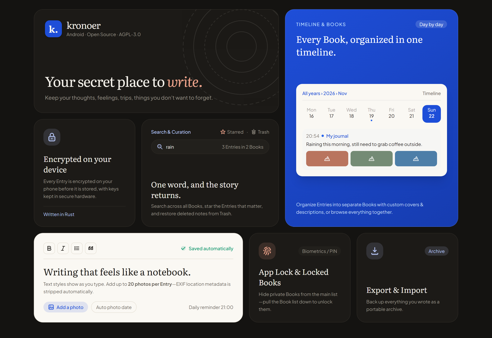
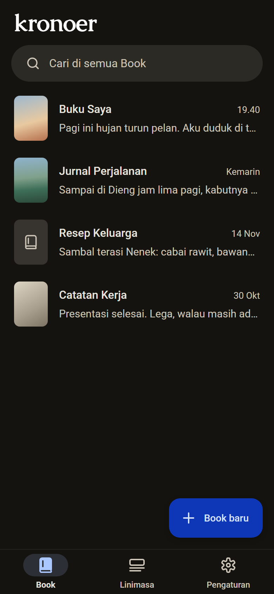
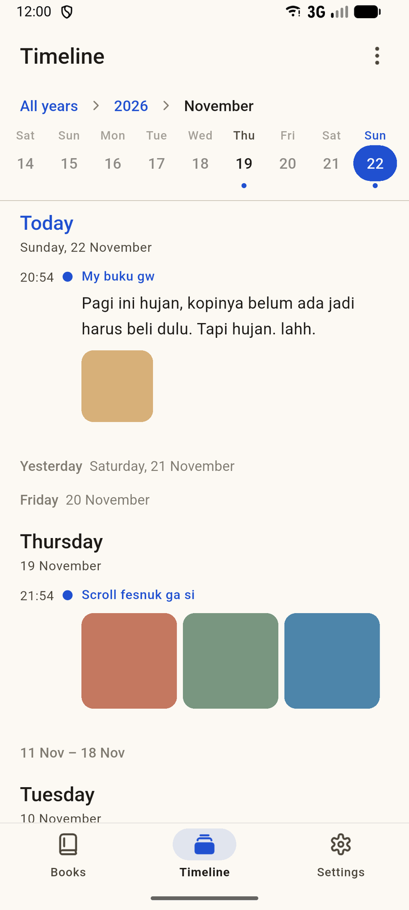
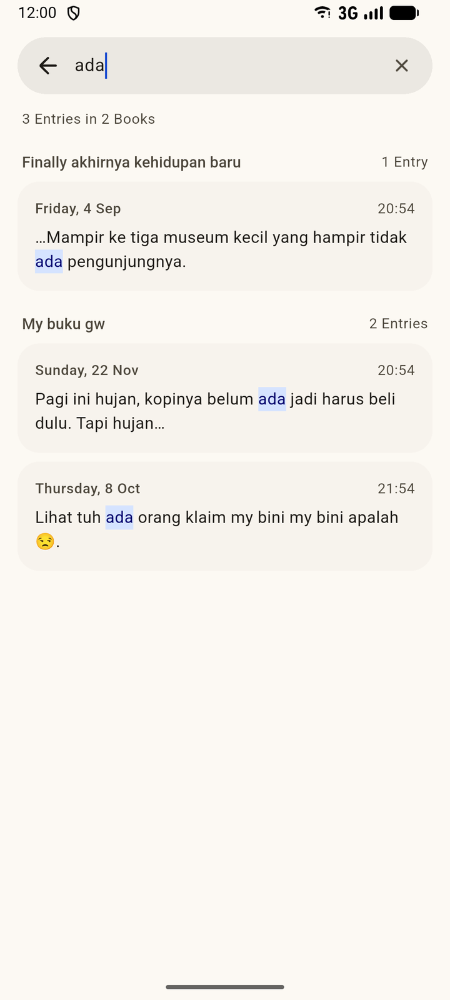

<div align="center">
  
  <h1>Kronoer</h1>

  <p><strong>A private place to write things down.</strong></p>

  <p>Kronoer is a mobile app for writing things down: thoughts, feelings, trips, things you don't want to forget. You write text with photos, and keep them in Books. Everything is encrypted on your phone before it is stored, with keys kept in the phone's secure hardware.</p>

  <p>
    
    
    
    <a href="LICENSE"></a>
    <a href="https://github.com/kronoer/kronoer/releases"></a>
  </p>
</div>

---

> [!WARNING]
> **The cryptography has not been reviewed by experts.** Kronoer's encryption design and its implementation were made without a cryptographer and have had no independent audit. They use standard primitives, but how those are put together may have flaws. Until it is reviewed, do not rely on Kronoer to protect anything whose exposure would harm you. Reviews are welcome: see [SECURITY.md](SECURITY.md).



## Features

Available features run on Android. For now, it's fully offline.

| Feature                  | What it does                                                                      | Status        |
| ------------------------ | --------------------------------------------------------------------------------- | ------------- |
| **Books**                | Keep your Entries in Books. Book has a name, description, and cover.              | ✅ Available   |
| **Entries**              | Write text with up to 20 photos; their location is removed.                       | ✅ Available   |
| **Entry date**           | Set when it happened, or use the time the photo was taken.                        | ✅ Available   |
| **Text styles**          | Make text bold, italic. Write lists, quotes, etc. The styles show as you type.    | ✅ Available   |
| **Autosave**             | Everything is saved as you type.                                                  | ✅ Available   |
| **Timeline**             | See every Entry from every Book, day by day.                                      | ✅ Available   |
| **Search**               | Find words across all Books or in one.                                            | ✅ Available   |
| **Stars**                | Star the Entries that matter to you.                                              | ✅ Available   |
| **Trash**                | Deleted Books and Entries wait in the Trash for a while, so you can restore them. | ✅ Available   |
| **Writing reminder**     | Get a daily reminder to write, at your chosen time.                               | ✅ Available   |
| **Languages and themes** | Use it in Indonesian or English, light or dark.                                   | ✅ Available   |
| **App lock**             | Lock the app with your phone's own lock: fingerprint, face, or PIN.               | ✅ Available   |
| **Locked Books**         | Hide Books from the rest of the app; pull the Book list down to open them.        | ✅ Available   |
| **Export and import**    | Save everything you wrote as an archive.                                          | ✅ Available   |
| **Account and sync**     | Keep your Books on all your devices, end-to-end encrypted.                        | 🔜 Coming soon |
| **Shared Books**         | Write together with family and friends.                                           | 🔜 Coming soon |

## Screenshots

<div align="center">
<table>
  <tr>
    <td align="center"><br /><sub><b>Welcome</b></sub></td>
    <td align="center"><br /><sub><b>Book list</b></sub></td>
    <td align="center"><br /><sub><b>Book</b></sub></td>
  </tr>
  <tr>
    <td align="center"><br /><sub><b>Editor</b></sub></td>
    <td align="center"><br /><sub><b>Timeline</b></sub></td>
    <td align="center"><br /><sub><b>Search</b></sub></td>
  </tr>
</table>
</div>

Screenshots of the app on Android, in light mode, with sample data.

## Kronoer Preview

Kronoer is not on the Play Store yet. Until it is, you can try it as **Kronoer Preview**, from the [pre-releases on GitHub](https://github.com/kronoer/kronoer/releases). Each release's notes say what changed, and [CHANGELOG.md](CHANGELOG.md) lists every release.

- **It is not the app from the Play Store.** Kronoer Preview is a separate app (`app.kronoer.preview`) that sits next to Kronoer from the Play Store, and it never updates into it.
- **Export is your only backup.** If you uninstall the Preview, reset your phone, or lose it, what you wrote is gone unless you exported it.
- **Moving to Kronoer from the Play Store.** Export from the Preview and import the Archive into Kronoer: Kronoer imports an Archive from any Preview. Nothing else moves over.
- **Which APK:** `arm64-v8a` for almost every phone; `armeabi-v7a` only if Android says "App not installed" or "not compatible".
- **Installing:** Kronoer Preview does not come from a verified developer yet. Where Android requires one, as in Indonesia, it installs only through the advanced flow (turn on Developer options, then allow apps from unverified developers; Android makes you wait 24 hours the first time) or with `adb install`.
- **Checking for a new version:** once a day the Preview asks GitHub whether a newer one is out. The request carries only your IP address and the app's User-Agent, and you can turn it off in Settings.
- **Checking the download:** every release lists the SHA-256 of its APKs and the fingerprint of the Preview's signing certificate, with how to check them.

## Repository

| Folder     | Contents                                                              |
| ---------- | --------------------------------------------------------------------- |
| `app/`     | Flutter app                                                           |
| `core/`    | Rust core: all cryptography, the reference implementation of `spec/`  |
| `spec/`    | Format and protocol specifications                                    |
| `server/`  | Go server: stores encrypted Entries and checks their readable headers |
| `proto/`   | API definitions for the server, in Protobuf (Connect-RPC)             |
| `docs/`    | Architecture: [docs/ARCHITECTURE.md](docs/ARCHITECTURE.md)            |
| `.github/` | CI workflows                                                          |

## Documentation

> [!NOTE]
> Our living documentation (vision, decisions, glossary, epics, stories) is written in a private Notion workspace and cannot be published yet. The Notion links below only open for the maintainers.

The Notion docs start from [Vision & Product](https://app.notion.com/p/419eb5d71fdd813cb5e4d54521ef4b82).
How we work is in the [Working Agreement](https://app.notion.com/p/419eb5d71fdd8160893dfe0949417ba0).

This repo only holds what rarely changes: this summary, [docs/ARCHITECTURE.md](docs/ARCHITECTURE.md), [SECURITY.md](SECURITY.md), and `spec/`.

## Development

Every task runs through [just](https://just.systems/): `just` lists the recipes in `justfile`, and the server's run from here as `just server <recipe>` (see `server/justfile`).

### Prerequisites

For the app and the Rust core:

- [FVM](https://fvm.app/): Flutter is pinned in `.fvmrc`
- [rustup](https://rustup.rs/): Rust and its Android targets are pinned in `rust-toolchain.toml`
- Android SDK with NDK `28.2.13676358`, and `adb` on `PATH`
- `cargo install flutter_rust_bridge_codegen --version 2.13.0 --locked`, the version pinned in `app/rust/Cargo.toml`

On Windows, also:

- [Strawberry Perl](https://strawberryperl.com/) on `PATH`, for host builds (`cargo test`) that compile the vendored OpenSSL
- [MSYS2](https://www.msys2.org/) in `C:\msys64` with Perl and make (`pacman -S perl make`), for Android builds. OpenSSL's build for Android needs a Unix-style Perl, so the Android build takes Perl and make from there by itself. If MSYS2 is elsewhere, set `MSYS2_ROOT`

For the server: Go (the version in `server/go.mod`) and Docker, which runs inside WSL on Windows.

### Run the app

On an emulator or device; extra arguments go to `flutter run`:

```sh
just run
```

On sample Books and Entries instead of your own, in a throwaway store whose changes are gone at the next launch (debug builds only):

```sh
just run-sample
```

The component gallery instead of the app, to check the base components against the design (debug builds only):

```sh
just run-gallery
```

`just dark` switches the connected device to dark mode, and `just light` back.

### Generated code

- After changing `app/rust/src/api/`, regenerate the Dart bindings with `just gen`.
- After changing an SVG in `app/vectors/`, compile it with `just vectors`.
- After adding an icon to `app/tool/keyline_icons.dart`, download and compile the icons with `just icons`.

### Format, test, and check

`just fmt` formats Rust and Dart. Then run the tests, and everything CI checks for Rust and the app (formatting, lints, and tests):

```sh
just test
just check
```

### Build an APK

A debug APK, or a release APK for 64-bit ARM phones, both into `app/build/app/outputs/flutter-apk/`:

```sh
just apk-debug
just apk-release
```

Install the release APK on the connected device over the old one, keeping its data:

```sh
just install-release
```

The Kronoer Preview APKs, one per ABI:

```sh
just apk-preview
```

Local release builds are signed with the debug key: fine for your own phone, never for a release. Only the release workflow signs with the Preview key.

### Release a Preview

1. Set `version` in `app/pubspec.yaml`, and in `CHANGELOG.md` turn `## [Unreleased]` into `## [x.y.z] - YYYY-MM-DD` with its compare link, above a new empty `## [Unreleased]`.
2. Push the tag `vx.y.z` on that commit. The `Preview release` workflow checks the tag against both files, builds and signs both APKs, and drafts a GitHub pre-release with the notes from `.github/release/preview-notes.md`.
3. Install both APKs from the draft, then publish it.

The workflow needs two repository secrets: `PREVIEW_KEYSTORE_BASE64`, the Preview keystore (PKCS12, key alias `kronoer-preview`) in base64, and `PREVIEW_KEYSTORE_PASSWORD`. The keystore is never in the repository; losing it means no Preview can be updated again.

### Server

Start PostgreSQL and RustFS, apply the migrations, and run the server:

```sh
just server up
just server migrate
just server run
```

`just server test` runs its tests (the database tests need `just server up`), `just server lint` lints Go and the proto files, and `just server down` stops the services and keeps their data.

## Contributing

Issues and pull requests are welcome from anyone. See [CONTRIBUTING.md](CONTRIBUTING.md).
Report security problems privately as described in [SECURITY.md](SECURITY.md).

## License

[AGPL-3.0-only](LICENSE) by default; `core/` and `spec/` are `MIT OR Apache-2.0`. [LICENSING.md](LICENSING.md) lists every exception, including third-party code and icons. The Kronoer name and logo are not covered by these licenses.
