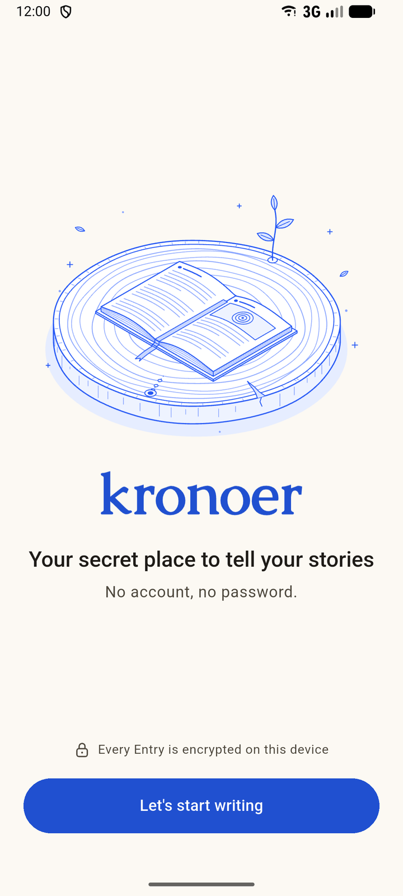
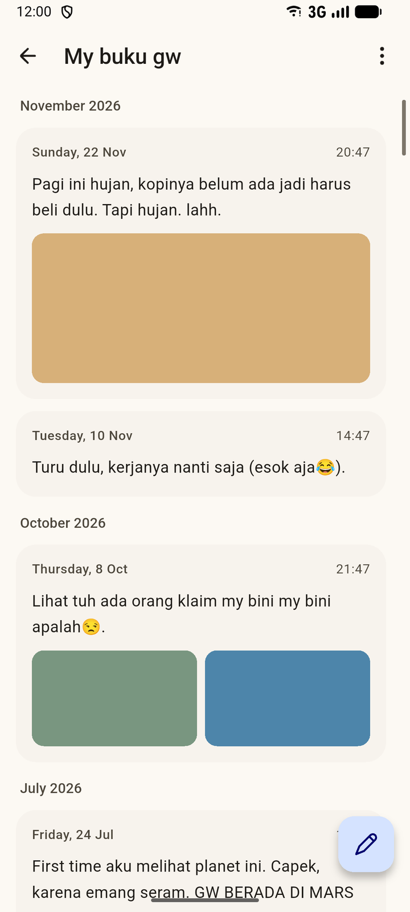
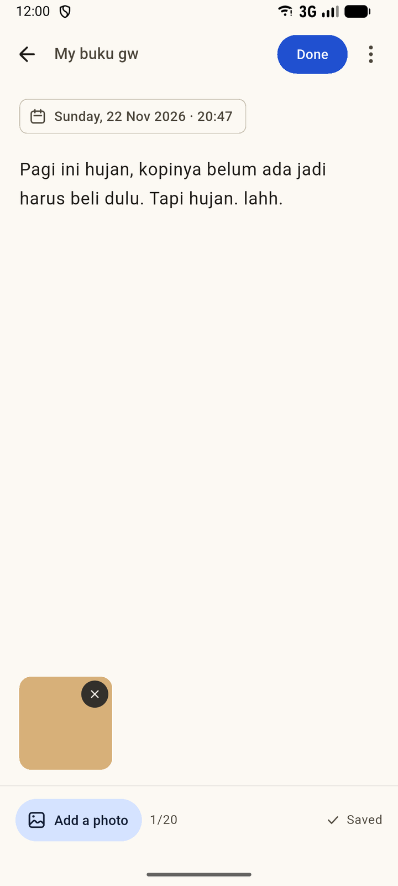

<div align="center">
  
  <h1>Kronoer</h1>

  <p><strong>A private place to write things down.</strong></p>
</div>

Entries live in **Books**: personal Books stay on your device with no login, shared Books are end-to-end encrypted on the server.

- **Write first, no login.** Login is only needed for sync and shared Books.
- **No password by default.** A PIN or biometrics only unlocks the app; it is never used for encryption.
- **The server cannot read.** Everything on the server is end-to-end encrypted.

Status: pre-MVP. The MVP is Android-only and fully offline.

## Screens

<p align="center">
  
  
  
</p>
<p align="center">
  
  
  
</p>

Screenshots of the app on Android, in light mode, with sample data.

## Repository

| Folder    | Contents                                          |
| --------- | ------------------------------------------------- |
| `app/`    | Flutter app (Android first)                       |
| `core/`   | Rust core: cryptography and the entry/Book format |
| `spec/`   | Format and protocol specifications                |
| `server/` | Go server (V1)                                    |
| `proto/`  | API definitions (V1)                              |

## Documentation

> [!NOTE]
> Our living documentation (vision, decisions, glossary, epics, stories) is written in a private Notion workspace and cannot be published yet. The Notion links below only open for the maintainers.

The Notion docs start from [Vision & Product](https://app.notion.com/p/419eb5d71fdd813cb5e4d54521ef4b82).
How we work is in the [Working Agreement](https://app.notion.com/p/419eb5d71fdd8160893dfe0949417ba0).

This repo only holds what rarely changes: this summary, [docs/ARCHITECTURE.md](docs/ARCHITECTURE.md), [SECURITY.md](SECURITY.md), and `spec/`.

## Development

Prerequisites:

- [FVM](https://fvm.app/): Flutter is pinned in `.fvmrc`
- [rustup](https://rustup.rs/): Rust is pinned in `rust-toolchain.toml`
- Android SDK with NDK `28.2.13676358`
- `cargo install flutter_rust_bridge_codegen --version 2.13.0 --locked`
- [just](https://just.systems/) for the recipes in `justfile`; `just` lists them

On Windows, also:

- [Strawberry Perl](https://strawberryperl.com/) on `PATH`, for host builds (`cargo test`) that compile the vendored OpenSSL
- [MSYS2](https://www.msys2.org/) in `C:\msys64` with Perl and make (`pacman -S perl make`), for Android builds. OpenSSL's build for Android needs a Unix-style Perl, so the Android build takes Perl and make from there by itself. If MSYS2 is elsewhere, set `MSYS2_ROOT`

Run the app on an emulator or device:

```sh
just run
```

To check the base components against the design, open the component gallery instead of the app (debug builds only):

```sh
just run-gallery
```

To try the app on sample Books and Entries instead of your own (debug builds only), run it with sample data. The samples go into a throwaway store, so changes to them are gone at the next launch:

```sh
just run-sample
```

For dark mode, switch the device to dark with `just dark` (`just light` switches back).

After changing `app/rust/src/api/`, regenerate the bindings with `just gen`. After changing an SVG in `app/vectors/`, compile it with `just vectors`.

Tests, and everything CI checks for Rust and the app:

```sh
just test
just check
```

A release APK for 64-bit ARM phones, then install it on the connected device over the old one, keeping its data:

```sh
just apk-release
just install-release
```

Until the app has its own signing key, release builds are signed with the debug key: fine for your own phone, not for a store.

The server's recipes run from here as `just server <recipe>`; see `server/justfile`.

## Contributing

Issues are welcome; code pull requests are not accepted yet. See [CONTRIBUTING.md](CONTRIBUTING.md).
Report security problems privately as described in [SECURITY.md](SECURITY.md).

## License

Each folder has its own license:

| Folder                      | License             |
| --------------------------- | ------------------- |
| `core/`, `spec/`            | `MIT OR Apache-2.0` |
| `app/`, `proto/`, `server/` | `AGPL-3.0-only`     |

Third-party code and icons keep their own licenses, for example `app/rust_builder/cargokit/` and `app/assets/icons/`.

The Kronoer name and logo are not covered by these licenses. Forks must use a different name and logo.